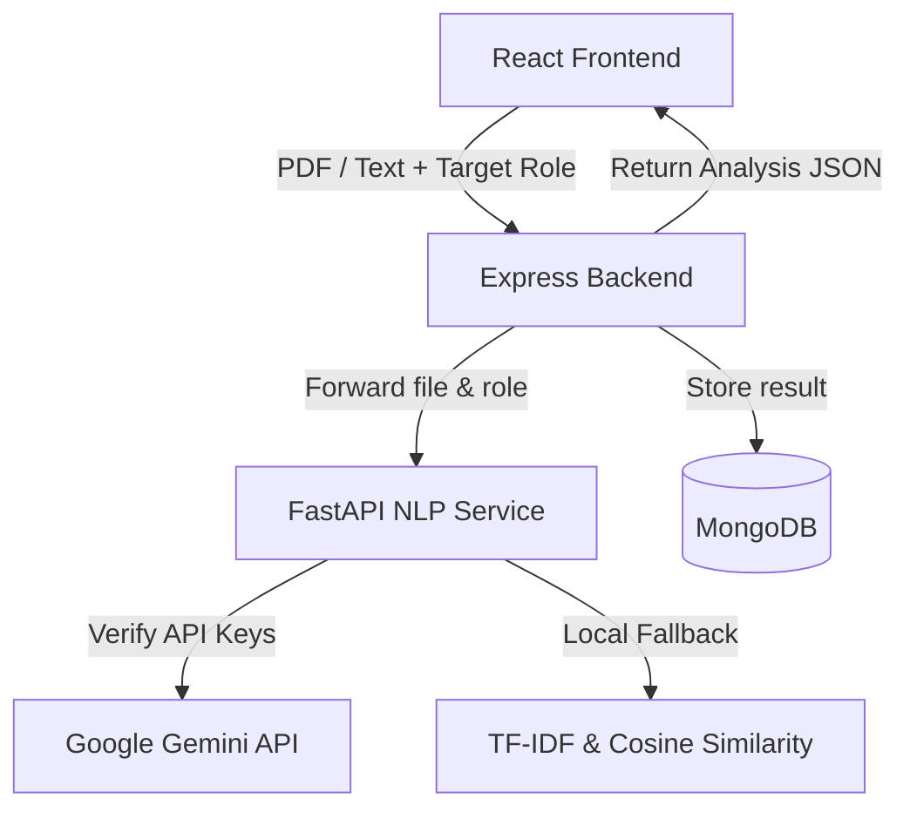

[](https://aravind-aariv-airesumeanalyser.netlify.app)

# 🤖 AI Resume Analyzer & ATS Optimization Engine

[](https://github.com/aravindaariv0904-collab/AI---RESUME-ANALYSER-/actions)
[](https://opensource.org/licenses/MIT)
[](https://fastapi.tiangolo.com/)
[](https://react.dev/)
[](https://tailwindcss.com/)
[](https://www.mongodb.com/)

An intelligent, multi-service ATS (Applicant Tracking System) simulation and optimization suite. This application parses PDF/text resumes, extracts candidate capabilities, matches them semantic-by-semantic against target job descriptions using **Google Gemini** or a local TF-IDF cosine-similarity fallback, and returns interactive, recruiter-grade analysis dashboards.

---

## 📖 Table of Contents
- [Problem Statement](#-problem-statement)
- [System Architecture](#-system-architecture)
- [Key Features](#-key-features)
- [Tech Stack](#-tech-stack)
- [Folder Structure](#-folder-structure)
- [Installation & Setup](#-installation--setup)
- [API Documentation](#-api-documentation)
- [Roadmap](#-roadmap)
- [License](#-license)

---

## ⚠️ Problem Statement
Modern recruiting uses automated ATS software to screen thousands of resumes. Many qualified candidates are rejected due to formatting issues, missing keywords, or poor alignment with the role's semantic context. This project solves that problem by giving job seekers a recruiter-grade evaluation of their resume, showing exactly what is missing and how to optimize it for search engines and AI evaluators.

---

## 🏗️ System Architecture



---

## ✨ Key Features
- **Intelligent Resume Parsing**: Securely extracts text from PDF and DOCX documents.
- **Dual NLP Engine**:
  - **Primary**: Structured LLM extraction using Google Gemini API to identify strengths, weaknesses, and experience gaps.
  - **Fallback**: Local Scikit-learn TF-IDF matching and Cosine Similarity calculation.
- **Recruiter Cockpit Dashboard**: Shows ATS score, matches found, missing keywords, next-step recommendations, and personalized project ideas.
- **Analysis History**: Saves past analyses to MongoDB for tracking career growth over time.
- **Glassmorphic UI**: High-fidelity dark mode with interactive score dials, progress bars, and animations.

---

## 🛠️ Tech Stack
- **Frontend**: React 19, Vite, Tailwind CSS v4, Lucide Icons, Framer Motion
- **Backend Gateway**: Node.js, Express, Mongoose, JWT (JSON Web Tokens), Multer
- **AI / NLP Service**: FastAPI, Uvicorn, Pydantic, Scikit-learn, PyPDF2, Google Generative AI SDK
- **Database**: MongoDB (Atlas in production, In-Memory server for local testing)

---

## 📁 Folder Structure
```
AI---RESUME-ANALYSER-/
├── .github/workflows/    # CI config files
│   └── ci.yml
├── docs/                 # Detailed architecture & API documentation
│   ├── architecture.md
│   ├── api.md
│   └── roadmap.md
├── ai-service/           # FastAPI NLP microservice (Python)
│   ├── main.py
│   ├── requirements.txt
│   └── tests/
├── backend/              # Express API server (Node.js)
│   ├── server.js
│   ├── models/
│   ├── routes/
│   └── tests/
└── website/              # Client Dashboard (React + Vite)
    ├── src/
    ├── package.json
    └── netlify.toml
```

---

## 🚀 Installation & Setup

### Prerequisites
- Python 3.10+
- Node.js 18+
- Google Gemini API Key (Optional but highly recommended)

### 1. Start AI NLP Service
```bash
cd ai-service
pip install -r requirements.txt
export GEMINI_API_KEY="your_api_key"  # On Windows: set GEMINI_API_KEY="your_api_key"
python main.py
```
FastAPI server runs on `http://localhost:8000`.

### 2. Start Backend Gateway
```bash
cd backend
npm install
npm run dev
```
Express server runs on `http://localhost:5000`. Set `MONGODB_URI` and `JWT_SECRET` in `.env` if deploying to production.

### 3. Launch Frontend Client
```bash
cd website
npm install
npm run dev
```
Vite dev server runs on `http://localhost:5173`.

---

## 🔌 API Documentation

### NLP Service (`/analyze` - POST)
Accepts multipart form-data:
- `file`: PDF file containing resume.
- `target_role`: String target role (e.g. "Software Engineer").

Returns:
```json
{
  "score": 85,
  "skills": ["Python", "React", "Node.js"],
  "missingSkills": ["Docker", "Kubernetes"],
  "skillsToLearn": ["Docker"],
  "projectSuggestions": ["Build a containerized microservice using Docker."],
  "hackathonsAndInternships": ["Apply for DevOps internships on LinkedIn."],
  "strengths": ["Excellent React and frontend core skills."],
  "weaknesses": ["No containerization skills detected."],
  "summary": "Your resume shows strong React alignment but lacks deployment/devops skills.",
  "experienceEvaluation": "Excellent work history. Consider adding quantified metrics to bullet points."
}
```

---

## 🗺️ Roadmap
- [ ] Parse DOCX directly on FastAPI server using `python-docx`.
- [ ] Add resume optimizer suggestions showing exactly where to insert missing keywords.
- [ ] Integrate with external job boards to pull live roles matching the resume's skills profile.

---

## 📄 License
This project is licensed under the MIT License - see the [LICENSE](LICENSE) file for details.
