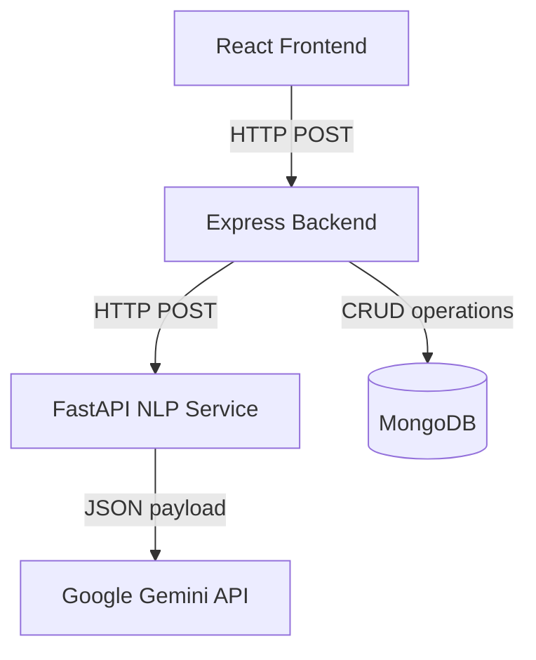

# Architecture & System Design

This document details the system design, microservice interaction, data flows, and clean code paradigms implemented in the AI Resume Analyzer.

## Overview

The application is structured as a classic **microservices architecture** consisting of:
1. **Frontend App (React/Vite)**: Serving a high-fidelity glassmorphic dashboard for job applicants.
2. **Backend Gateway Service (Node/Express)**: Managing authentication, session history, and database operations.
3. **AI / NLP Microservice (FastAPI)**: Running resource-intensive PDF parsing, TF-IDF vectorization, and Gemini API LLM inference.

## Service Responsibilities

### 1. Website Frontend (React)
- **Role**: Client side interactions, file uploads, score animations, state management.
- **Security**: Access tokens stored securely in `localStorage` and sent in headers as `x-auth-token`.
- **UI Design**: A custom Tailwind v4 glassmorphic theme designed to feel like a premium recruiter cockpit.

### 2. Backend Gateway (Express)
- **Role**: API Gateway, user authorization, and data store coordinator.
- **Database**: Mongoose models map users to their analysis histories. In development, a local-first in-memory server is loaded dynamically for zero-config database setups.
- **Error Boundaries**: Comprehensive express error handling middleware prevents data leakages during database dropouts.

### 3. AI / NLP Service (FastAPI)
- **Role**: Independent worker node responsible for resume matching and ranking.
- **Resilience Strategy**: 
  - **Gemini Engine**: Performs natural language reasoning to evaluate resume strengths, missing technical stacks, and recommend specific next projects.
  - **TF-IDF & Cosine Similarity**: An internal backup engine runs in case of network outages or missing API keys, mapping keywords to roles.

## Data Schema & Models

### User Model
- `name` (String, required)
- `email` (String, unique, required)
- `password` (String, hashed with bcryptjs)
- `university` (String)
- `graduationYear` (Number)

### Analysis History Model
- `userId` (ObjectId, references User)
- `targetRole` (String, required)
- `originalFilename` (String, required)
- `score` (Number, required)
- `skills` (Array of Strings)
- `missingSkills` (Array of Strings)
- `projectSuggestions` (Array of Strings)
- `summary` (String)
- `experienceEvaluation` (String)
